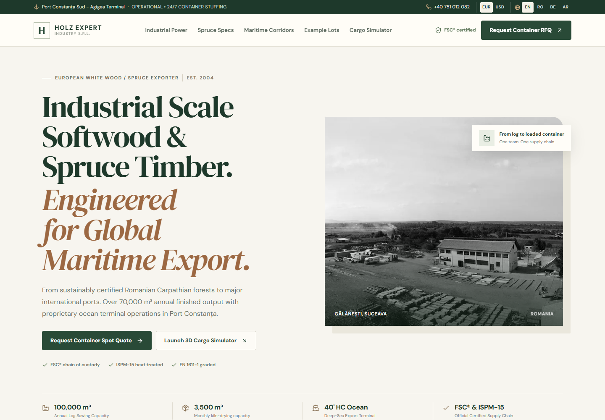
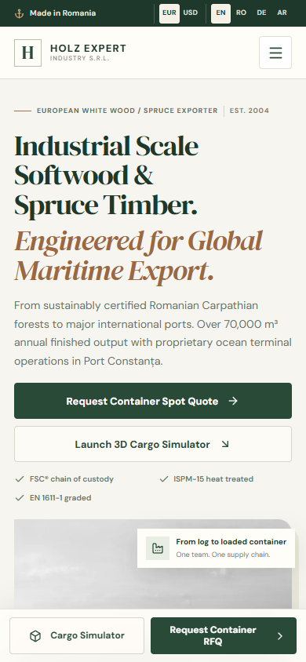
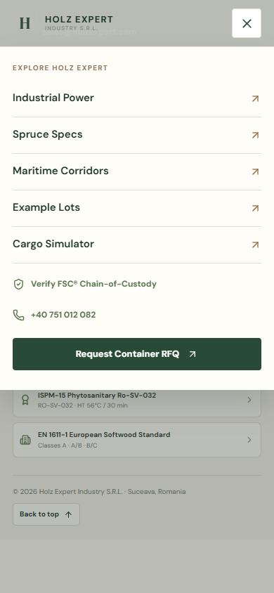
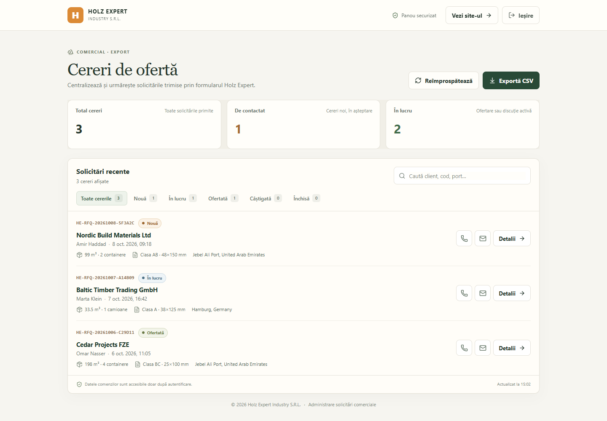
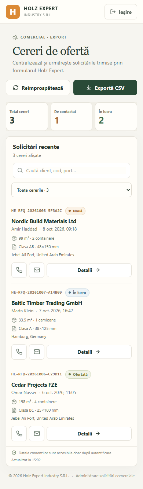
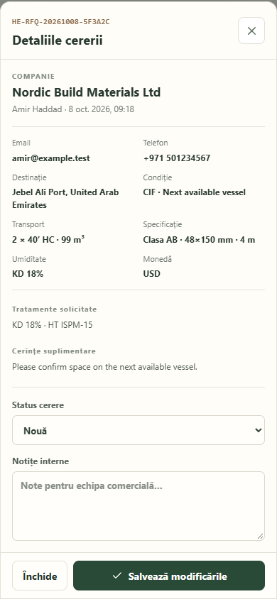

# Holz Expert

A multilingual B2B website for Holz Expert Industry S.R.L., focused on Romanian spruce timber, technical specifications and export logistics.

## Screenshots

### Website — desktop (1440 × 1000)



### Website — mobile (390 × 844)



### Mobile navigation, opened from the bottom of the page



### Admin dashboard — desktop and mobile

The screenshots below use fictional sample requests so no customer information is included.







## Admin page

Open `/admin/` to sign in and manage customer RFQs. The dashboard includes status filters, search, order details, internal notes, direct email and phone actions, and CSV export. It is designed for touch screens and uses order cards instead of a wide table on mobile.

GitHub Pages serves the static website and admin. A separate Cloudflare Worker provides the API, and Cloudflare D1 stores the requests. The admin API uses signed, expiring sessions; customers can submit an RFQ but cannot read existing orders. The API limits form and login attempts and returns only the latest 500 requests. Email notifications are not sent; new RFQs appear in the admin inbox.

## Main sections and technologies

- React, TypeScript and Vite for the website and admin interface
- Cloudflare Workers for form processing, admin authentication and the orders API
- Cloudflare D1 for order storage
- Production platform and mill photography
- Timber grades, dimensions and export treatments
- Maritime routes and destination-port details
- Cargo loading simulator
- Example inventory lots with filters
- Multi-step request-for-quotation form
- Responsive mobile navigation and fixed quote actions

## Run locally

Requirements: Node.js and npm. Wrangler is included in the development dependencies.

```bash
npm ci
npm run cloudflare:db:apply:local
```

Copy `cloudflare/.dev.vars.example` to `cloudflare/.dev.vars` and set a local admin password and signing secret. In another terminal, start the API:

```bash
npm run cloudflare:dev
```

In another terminal, start the website and admin:

```bash
npm run dev
```

Then open `http://localhost:5173/` or `http://localhost:5173/admin/`. Local D1 data is stored in the ignored `cloudflare/.wrangler/` folder. Copy `.env.example` to `.env.local` if you want to point the website directly at a different API URL.

Create a production build with:

```bash
npm run build
```

Run the test suite with:

```bash
npm test
```

## GitHub Pages and Cloudflare setup

GitHub Pages cannot run server-side PHP, so the website uses Cloudflare Workers and D1 for the server-side features. Both have free plans suitable for a low-volume site. Worker and D1 have daily usage limits; when D1 reaches a free limit, its queries fail until the limit resets. See [Workers pricing](https://developers.cloudflare.com/workers/platform/pricing/), [Workers limits](https://developers.cloudflare.com/workers/platform/limits/) and [D1 pricing](https://developers.cloudflare.com/d1/platform/pricing/).

1. Create a free Cloudflare account. Wrangler is included in the project development dependencies.
2. Run `npx wrangler login`, then create the database in the EU with `npx wrangler d1 create holzexpert --jurisdiction eu --update-config --config cloudflare/wrangler.toml`. Confirm that Wrangler replaced the placeholder `database_id` in `cloudflare/wrangler.toml`.
3. Apply the schema using `npm run cloudflare:db:apply:remote`.
4. Set the admin password and a separate random session-signing secret. Keep both as Cloudflare secrets, never in frontend code or Git:

   ```bash
   npx wrangler secret put ADMIN_PASSWORD --config cloudflare/wrangler.toml
   npx wrangler secret put SESSION_SECRET --config cloudflare/wrangler.toml
   ```

   Use a unique admin password of at least 16 characters and a randomly generated `SESSION_SECRET` of at least 32 characters.
5. Publish the API using `npm run cloudflare:deploy`. Wrangler prints the Worker URL, typically `https://holzexpert-api.<your-account>.workers.dev`.
6. In GitHub, set the repository Actions variable `VITE_HOLZ_API_URL` to the Worker URL with `/api` appended. If using a custom domain, add its origin to `ALLOWED_ORIGINS` in the Worker configuration.
7. In the repository's **Settings → Pages**, select **GitHub Actions** as the build and deployment source. The included workflow builds the project at `/website-holzexpert/`, publishes it and reads the API URL from the repository variable. It skips deployment until `VITE_HOLZ_API_URL` is configured. For a custom domain at the site root, set the repository Actions variable `GITHUB_PAGES_BASE_PATH` to `/` and add that domain to the Worker `ALLOWED_ORIGINS` list.

For local API development, set local secrets in `cloudflare/.dev.vars` (this file is ignored by Git):

```text
ADMIN_PASSWORD=choose-a-local-password
SESSION_SECRET=choose-a-random-secret-of-32-characters-or-more
```

The Vite development server forwards `/api` to the local Worker at port 8787. The Worker runs D1 locally and does not need a PHP installation or a Supabase project.
